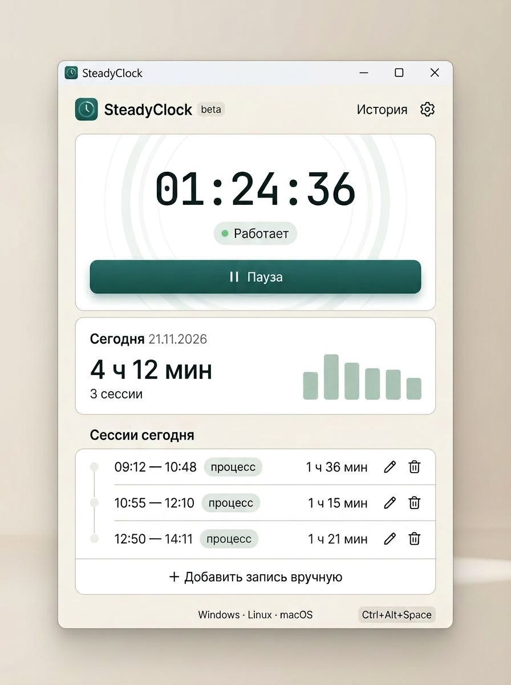

<p align="center">
  
</p>

<p align="center">
  <strong>Тихая сосредоточенность. Один таймер. Локальная история.</strong>
</p>

<p align="center">
  <code>Windows 10/11</code>
  <code>Avalonia 12</code>
  <code>.NET 10</code>
  <code>SQLite</code>
  <code>Offline-first</code>
  <code>MIT License</code>
</p>

---

**SteadyClock** — спокойный офлайн-трекер времени для Windows. Интерфейс
«Quiet Focus» построен вокруг одного таймера: тёплый фарфоровый фон, глубокий
хвойный акцент, крупные цифры и ничего лишнего.

Приложение не обращается к интернету: история, настройки и логи остаются на
компьютере. Установка и права администратора не нужны.

## Возможности

- Один таймер: старт, пауза, продолжение, стоп.
- Автопауза по простою с настройкой порога, автовозобновления и блокировки экрана.
- Два способа вычитания простоя: от последней активности или с момента обнаружения.
- История по дням с итогами за сегодня, неделю и всё время.
- Семидневный спарклайн на главном экране.
- Ручные записи и комментарий к активной сессии.
- Уведомления с встроенными звуками, тихими часами и настройкой событий.
- Режим «По приложению»: автостарт и автостоп по выбранному процессу.
- Глобальные горячие клавиши и автозапуск при входе в Windows.
- Системный трей, закрытие в трей и диалог выхода с активной сессией.
- Светлая и тёмная темы.
- Одноэкземплярный запуск.

## Дизайн

Концепция и исходные макеты находятся в [`design/`](design/README.md).



- Шрифты: Inter для интерфейса, JetBrains Mono для таймера.
- Палитра: Porcelain `#F5F2EA`, Pine `#1E5B54`, Sage `#A9C6BB`, Coral `#E08A6A`.
- Карточки 20–24 px, поля 12 px, кнопки pill/14 px.
- Анимации 100–200 ms ease-out.

## Скачать

Готовые Windows-сборки публикуются в разделе **Releases** репозитория.
Установка не требуется: распакуйте архив и запустите `SteadyClock.exe`.

## Где хранятся данные

```
%LOCALAPPDATA%\MyTimeTracker\
  data.db          SQLite: сессии и сегменты
  settings.json    настройки
  logs\            локальные логи с ротацией
```

Папка `MyTimeTracker` сохранена для обратной совместимости с предыдущими
версиями. Для резервной копии закройте приложение и скопируйте папку целиком.

## Сборка

Нужен .NET 10 SDK.

```powershell
dotnet build src/SteadyClock.Desktop/SteadyClock.Desktop.csproj -c Release
dotnet test tests/MyTimeTracker.Tests/MyTimeTracker.Tests.csproj -c Release
```

Публикация Windows-сборок (x64 и ARM64):

```powershell
./build/publish-desktop.ps1
```

Готовые архивы появятся в `publish/`.

## Тесты

Покрыто 39 детерминированными сценариями:

- работа таймера, пауза, продолжение и восстановление после сбоя;
- простой, сон, блокировка экрана и системные разрывы;
- два режима вычитания простоя;
- ручные записи, пересечения и будущие даты;
- SQLite-репозиторий, сегменты и источники сессий;
- настройки, напоминания и уведомления.

## Приватность

- Нет аккаунтов, телеметрии и проверки обновлений.
- Нет сетевых запросов и CDN.
- Уведомления и звуки работают локально.
- Единственный IPC — локальный канал одноэкземплярного запуска.

## Лицензия

MIT. Copyright © GGadjiev.
